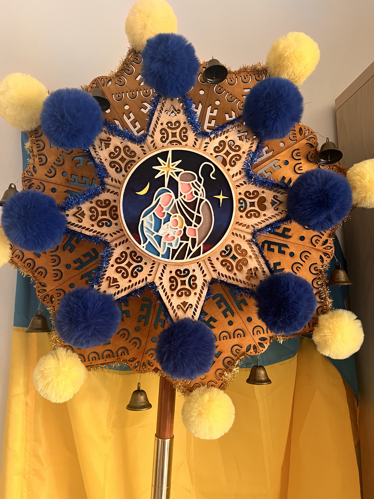

# Ukrainian Zvizda (Nativity Star)

📹 [Watch the finished star (zvizda-v1.MOV)](zvizda-v1.MOV)

This repository holds the design, bill of materials, and build documentation for a hand-built, laser-cut **Zvizda** — the traditional Ukrainian Nativity Star carried by carolers in the **Vertep** (Vertep, nativity play). It was made for Christmas 2025, built from the ground up as a personal family project.

## The Design

The star is built from **three nested layers** (L1, L2, L3), each cut from birch plywood on an xTool laser cutter. The vector cut files for each layer are `.xs` project files, which require [xTool Creative Space](https://www.xtool.com/) to open and edit.

- [1 - design/layer1of3/L1.xs](1%20-%20design/layer1of3/L1.xs) — smallest/innermost layer
- [1 - design/layer2of3/L2.xs](1%20-%20design/layer2of3/L2.xs) — middle layer
- [1 - design/layer3of3/L3.xs](1%20-%20design/layer3of3/L3.xs) — largest/outermost layer

### Dimensions

Diameter = 2 × (distance from the true center/hub to the farthest beam tip), measured from the actual vector geometry in each `.xs` file (not from bounding boxes or the shared reference circle, which is only a positioning guide and is NOT the real finished size for L2/L3).

| Layer | Beam length (center → farthest tip) | Diameter |
|---|---|---|
| L1 | ≈ 78.8 mm | **≈ 157.6 mm (6.2 in)** |
| L2 | 203.2 mm (exact, confirmed via the layer's registration circle) | **406.4 mm (16.0 in, exact)** |
| L3 | ≈ 284.8 mm (from the leaf/backing piece length in `L3-single-leaf`) | **≈ 569.6 mm (22.4 in)** |

Notes:
- **L1** is a single self-contained star piece; its center is its own geometric center, and the farthest point is a star tip.
- **L2** is built from repeating leaf ("beam") units arranged around a hub. The hub location is pinned down exactly by a registration circle in the `L2-one-leaf` canvas, giving a clean 203.2 mm beam length (16 in diameter), cross-checked two independent ways (bounding geometry and raw path data).
- **L3** is also leaf/beam-based, but its design file contains a stale/duplicated canvas (literally reused from the L2 project, same internal canvas ID) that should be ignored. The real L3 geometry lives in `L3-single-leaf`/`L3-layout`, which has no explicit registration circle, so the beam length is taken from the leaf/backing piece's full length (284.8 mm) using the same hub-to-tip convention validated on L2. This number is somewhat less certain than L1/L2 since it lacks a second independent check.

Beam sizes do differ noticeably per layer (consistent with a 3-layer tree-topper star that grows larger from L1 to L3).

The pole and mounting housing (bolt, bearings, hub) that let the layers spin freely is designed in Onshape, with **Danyyil Zelyanovskyy** helping with the 3D design of the housing:

- [Housing / hub design — Onshape CAD](https://cad.onshape.com/documents/32f6b3a7d6b3c0da99b364aa/w/6814df93cebc6c3eb21067c8/e/82a748862f8aba420928be88)

## Bill of Materials

Hardware, bearings, finish, and decoration supplies are listed in [2 - BOM/bom.md](2%20-%20BOM/bom.md).

## Inspiration & Resources

- [Hutsul Ornament](https://hutsulornament.art/) — traditional Hutsul ornament patterns, used as reference for decoration
- [РІСУ — Різдвяні звізди, вертепи і шопки із Закерзоння](https://risu.ua/rizdvyani-zvizdi-vertepi-i-shopki-iz-zakerzonnya_n102133#goog_rewarded) — history and regional examples of Nativity stars and vertep shopkas
- [nasze-slowo.pl — historical photo of a star and shopka frame](https://www.nasze-slowo.pl/wp-content/uploads/2020/01/shagala.-vgori-zvizdi-vnizu-shopka-i-karkas-zvizdi.jpg)

## Repository Structure

| Path | Contents |
|---|---|
| [prose.md](prose.md) | The story behind the project — why it was built, the Vertep tradition, and the build log |
| [1 - design/](1%20-%20design/) | xTool `.xs` laser-cut designs for all three star layers, plus assembly photos and the pole/bolt reference image |
| [1 - design/layer1of3/](1%20-%20design/layer1of3/) | `L1.xs` design and photos of the innermost layer, assembled |
| [1 - design/layer2of3/](1%20-%20design/layer2of3/) | `L2.xs` design, gasket artwork, and mockups for the middle layer |
| [1 - design/layer3of3/](1%20-%20design/layer3of3/) | `L3.xs` design, laser-cutting and assembly photos, and gasket photos for the outermost layer |
| [2 - BOM/bom.md](2%20-%20BOM/bom.md) | Full bill of materials: bolts, nuts, rivet nuts, bearings, plywood, pole, finish, bells, tinsel |
| [3 - Paint and Decoration/](3%20-%20Paint%20and%20Decoration/) | Photos of decorating with bells and tinsel, and the final assembled star |
| [ideas/](ideas/) | Reference photos, screenshots, and videos gathered during research and early builds |
| `zvizda-v1.png`, `zvizda-v1.MOV` | Photo and video of the finished first-version star |

## Acknowledgments

This was very much a family project. Huge thanks to everyone who helped with design, decoration, and manufacturing:

- [Danyyil Zelyanovskyy](https://www.linkedin.com/in/danyyil-zelyanovskyy-7b0917321) — helped with the 3D design of the housing
- [Tetyana Zelyanovska](https://www.linkedin.com/in/tetyana-zelyanovska-78239731/) — organizer of the Vertep that inspired this project, and helped with decoration
- **Pavlo Zelyanovskyy** — helped with decoration and manufacturing
- **Lev Zelyanovskyy** — helped with decoration and manufacturing
- **Kava** (dog) and **Kotto** (cat) — quality assurance and moral support throughout

## Copyright & License

**Layer 1** is adapted from [Laser Cut Nativity Scene Christmas Ornament with Wood Background](https://www.atomm.com/project/73380) by [bodnarjakub](https://www.atomm.com/@706303), licensed under [CC BY 4.0](https://creativecommons.org/licenses/by/4.0/); I modified it for this design.

All other original content in this repository is © **[Mykhailo Zelyanovskyy](https://www.linkedin.com/in/michaz/)**. All rights reserved. Please ask permission before reusing it.

---
